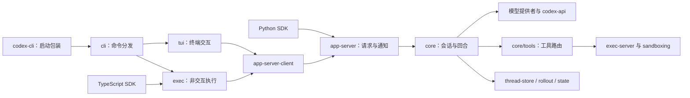

# Codex 源码知识图谱

这份图谱用于学习 Codex CLI 的结构、模块关系和主要执行路径。分析覆盖仓库的源码、测试、配置、文档和构建定义，说明与学习导览使用中文。

源代码基线：[c0cc9fc820f62e4dbdde68214dd6d792d6c8a7ee](https://github.com/AManHasNoName12138/codex/tree/c0cc9fc820f62e4dbdde68214dd6d792d6c8a7ee)。生成工具为 [Understand-Anything 2.9.8](https://github.com/Egonex-AI/Understand-Anything/tree/532a2e97dc007104f9a1b8d11b6cc16ae7c8cd3a)，执行了扫描、依赖解析、分批结构提取、语义分析、合并审查、架构分层、学习导览和校验流程。

## 阅读入口

- [knowledge-graph.json](knowledge-graph.json)：可供 Understand-Anything 仪表盘加载的完整图谱。
- [validation-report.json](validation-report.json)：格式、文件覆盖、引用、源码行号和分层校验结果。
- [dashboard-check.json](dashboard-check.json)：真实 Chromium 中的仪表盘加载与渲染检查。
- [analysis-report.json](analysis-report.json)：生成来源、分析范围、解析器限制和警告。
- [meta.json](meta.json) 与 [fingerprints.json](fingerprints.json)：后续增量分析所需的基线。

## 主要执行路径

下图展示主要入口和执行路径。箭头表达组件之间的衔接；具体文件导入、类型包含和清单依赖见完整图谱。



从 [CLI 入口](../codex-rs/cli/src/main.rs)理解命令分发，再看 [app-server 请求处理](../codex-rs/app-server/src/message_processor.rs)和 [core 会话](../codex-rs/core/src/session/mod.rs)。[TypeScript SDK](../sdk/typescript/src/exec.ts)启动 `codex exec --experimental-json`；[Python SDK](../sdk/python/src/openai_codex/client.py)使用 app-server 的 JSON-RPC 请求和通知。当前 [exec](../codex-rs/exec/src/lib.rs)与终端界面通过 app-server 客户端接口衔接运行时。

## 图谱规模

| 项目 | 数量 |
| --- | ---: |
| 源提交受控文件 | 10,264 |
| 分析文件 | 10,183 |
| 默认排除文件 | 81 |
| 图节点 | 68,121 |
| 图关系 | 129,845 |
| 架构层 | 10 |
| 学习步骤 | 15 |

节点类型：`file` 9,189；`class` 9,510；`function` 48,282；`pipeline` 29；`table` 114；`schema` 113；`config` 618；`document` 264；`service` 1；`endpoint` 1。

关系类型：`imports` 10,530；`contains` 67,459；`exports` 27,742；`calls` 21,415；`tested_by` 34；`defines_schema` 128；`documents` 45；`related` 880；`configures` 380；`depends_on` 1,232。

## 架构分层

分层成员为文件级节点，包括 146 个表、Schema 等文件内定义节点。函数和类通过 `contains` 关系归属文件，在仪表盘中按需展开。

| 层 | 职责 | 层成员数 |
| --- | --- | ---: |
| 用户界面与 SDK | 提供 CLI、终端界面、语音交互与非交互执行入口，TUI 和 exec 通过 AppServerClient 驱动会话，Python SDK 连接 app-server，TypeScript SDK 包装 codex exec。 | 3,201 |
| 应用服务与会话接入 | 通过 app-server 请求处理、进程内或远程客户端、守护进程及 stdio、Unix 套接字和 WebSocket 传输管理会话接入、通知与服务生命周期。 | 519 |
| 协议与类型契约 | 定义 Codex 消息、app-server、执行服务、代码会话及后端 API 的共享数据契约，维护协议生成器、TypeScript 类型和 JSON Schema。 | 1,412 |
| 代理编排与上下文 | 组织核心代理的线程与回合生命周期、角色和提示上下文、记忆生成、Guardian 审查、目标推进及代理间消息协作。 | 1,633 |
| 工具扩展与代码运行时 | 提供工具目录、补丁应用、MCP、连接器、技能、hook 与插件扩展，并通过代码会话客户端、宿主和 V8 运行时协调嵌套工具执行。 | 974 |
| 执行环境与安全隔离 | 通过 exec-server 统一进程、文件与网络访问，组合命令执行策略、网络代理、进程加固及 Linux、Windows 和 MXC 沙箱隔离。 | 626 |
| 模型与云服务接入 | 接入模型提供者、Responses API、本地模型与云端任务服务，管理模型目录、受管云配置、账户凭据、身份交换和运行时代理注册。 | 429 |
| 会话状态与持久化 | 维护 SQLite 状态与迁移、线程和输入历史、可回放会话日志、代理关系、附件存储及外部代理数据导入。 | 506 |
| 共享运行基础设施 | 提供分层运行配置和功能开关、文件与 Git 操作、HTTP 与套接字、遥测反馈、安装上下文及跨 crate 复用的路径、进程、缓存和文本工具。 | 597 |
| 工程构建与仓库文档 | 维护 Cargo 与 Bazel 工作区、CI/CD、跨平台打包签名和发布、第三方构建适配、开发检查工具以及仓库级使用和贡献文档。 | 432 |

## 建议阅读顺序

1. **项目用途与入口**

   先阅读仓库 README，了解 Codex CLI 的用途、安装和登录方式，以及编辑器、桌面和云端入口之间的关系。它把首次使用与贡献、构建文档连接起来，适合作为整段导览的起点。接下来将沿着命令行入口、应用服务和核心回合逐层追踪一次请求。

   阅读：[README.md](../README.md)。

2. **工作区与命令路由**

   承接项目概览，先用 Rust 工作区清单认识 CLI、核心代理、协议和执行环境等 crate 的组织方式，再阅读顶层命令入口。工作区统一共享依赖、构建配置和检查规则，CLI 则把默认交互模式与 exec、登录、MCP、插件、应用服务器等子命令分派给对应组件。理解构建边界和命令路由后，下一步便能比较同一运行时的不同使用方式。

   阅读：[codex-rs/README.md](../codex-rs/README.md)、[codex-rs/Cargo.toml](../codex-rs/Cargo.toml)、[codex-rs/cli/src/main.rs](../codex-rs/cli/src/main.rs)。

   学习提示：Cargo 工作区用多个 crate 划分编译与依赖边界；共享依赖和 lint 配置集中声明，使各组件遵守一致的工程约定。

3. **交互与批量入口**

   沿着上一站的命令分派，比较终端界面 TUI 与非交互 exec 的启动流程。TUI 载入配置后选择进程内或远程 AppServerClient，exec 创建进程内客户端并把通知转换为文本或 JSONL 事件；两者通过应用服务接口启动、恢复和驱动会话。终端的会话协调模块进一步把线程切换、后台事件、用户提交和批准操作连接到界面，说明下一步为何需要明确的协议契约。

   阅读：[codex-rs/tui/src/lib.rs](../codex-rs/tui/src/lib.rs)、[codex-rs/tui/src/app_server_session.rs](../codex-rs/tui/src/app_server_session.rs)、[codex-rs/exec/src/lib.rs](../codex-rs/exec/src/lib.rs)、[codex-rs/app-server-client/src/lib.rs](../codex-rs/app-server-client/src/lib.rs)。

4. **应用服务协议**

   客户端与服务端需要共同理解线程、回合、请求和通知，本站把上一站的接口调用落实为协议数据结构。先从应用服务文档建立背景，再查看线程启动与回合状态的 Rust 定义，并对照生成的 TypeScript 请求和通知类型。请求类型与通知类型连接了大量协议文件，掌握这组契约后，便能进入服务端查看消息如何被处理。

   阅读：[codex-rs/app-server/README.md](../codex-rs/app-server/README.md)、[codex-rs/app-server-protocol/src/protocol/v2/thread.rs](../codex-rs/app-server-protocol/src/protocol/v2/thread.rs)、[codex-rs/app-server-protocol/src/protocol/v2/turn.rs](../codex-rs/app-server-protocol/src/protocol/v2/turn.rs)、[codex-rs/app-server-protocol/schema/typescript/ClientRequest.ts](../codex-rs/app-server-protocol/schema/typescript/ClientRequest.ts)、[codex-rs/app-server-protocol/schema/typescript/ServerNotification.ts](../codex-rs/app-server-protocol/schema/typescript/ServerNotification.ts)。

   学习提示：TypeScript 联合类型可以表达多种通知消息的序列化形态；阅读生成类型时，应把它们与 Rust 协议定义放在一起理解。

5. **服务分发与线程**

   带着上一站的协议词汇，阅读 app-server 的启动入口和请求分发中心，观察连接初始化、协议校验、通知及关闭信号如何协同。分发器把 JSON-RPC 或进程内类型化请求交给线程、回合、账户和配置等处理器，同时管理对端响应和请求串行化。核心线程管理器负责创建、恢复、注册和分叉线程，并衔接历史装载，为进入具体会话与回合建立桥梁。

   阅读：[codex-rs/app-server/src/lib.rs](../codex-rs/app-server/src/lib.rs)、[codex-rs/app-server/src/message_processor.rs](../codex-rs/app-server/src/message_processor.rs)、[codex-rs/core/src/thread_manager.rs](../codex-rs/core/src/thread_manager.rs)。

6. **会话与回合循环**

   在线程接入之后，核心会话保存长期配置、服务和运行状态，回合上下文则汇集本轮环境、沙箱、shell 快照与依赖。会话模块、上下文模块和回合执行紧密相连，回合循环负责准备输入、运行 hooks、请求模型、消费流式响应和工具调用，并协调压缩、预算与结束条件。区分共享会话状态和本轮设置后，下一步就能理解模型请求与工具执行为何需要使用一致的上下文。

   阅读：[codex-rs/core/src/session/mod.rs](../codex-rs/core/src/session/mod.rs)、[codex-rs/core/src/session/session.rs](../codex-rs/core/src/session/session.rs)、[codex-rs/core/src/session/turn_context.rs](../codex-rs/core/src/session/turn_context.rs)、[codex-rs/core/src/context/mod.rs](../codex-rs/core/src/context/mod.rs)、[codex-rs/core/src/session/turn.rs](../codex-rs/core/src/session/turn.rs)。

7. **配置与模型接入**

   承接回合所需的上下文，先看核心 Config 如何合并用户、项目、启动覆盖与受管要求，并解析模型、权限、网络和认证设置。模型提供者配置描述能力、认证方式及 API 路由，登录组件保存和刷新凭据；模型客户端据此维护请求状态、路由与遥测。模型 API 层封装请求和事件解析，客户端协调 Responses HTTP 与 WebSocket 的续接和回退，从而把模型输出送回上一站的回合循环。

   阅读：[codex-rs/core/src/config/mod.rs](../codex-rs/core/src/config/mod.rs)、[codex-rs/model-provider-info/src/lib.rs](../codex-rs/model-provider-info/src/lib.rs)、[codex-rs/login/src/lib.rs](../codex-rs/login/src/lib.rs)、[codex-rs/core/src/client.rs](../codex-rs/core/src/client.rs)、[codex-rs/codex-api/src/lib.rs](../codex-rs/codex-api/src/lib.rs)。

8. **工具计划与路由**

   模型返回工具请求后，工具计划先根据核心上下文、MCP 暴露策略和各工具来源建立注册表与路由器，确保可见规格对应实际处理器。注册表保存工具规格、审核能力和执行接口，路由器把模型请求解析为 ToolCall，并传递调用上下文、取消状态和结果。这组紧密协作的模块解释了工具如何进入回合，下一站继续追踪工具真正执行前的批准与隔离。

   阅读：[codex-rs/core/src/tools/spec_plan.rs](../codex-rs/core/src/tools/spec_plan.rs)、[codex-rs/core/src/tools/registry.rs](../codex-rs/core/src/tools/registry.rs)、[codex-rs/core/src/tools/router.rs](../codex-rs/core/src/tools/router.rs)、[codex-rs/core/src/tools/context.rs](../codex-rs/core/src/tools/context.rs)。

9. **执行批准与隔离**

   接着上一站的工具分发，编排器协调执行尝试、批准与沙箱结果，并在环境变化或重试时维持同一调用的策略语义。批准状态与原因由沙箱辅助模块承接，执行策略组件解析规则和匹配命令，exec-server 统一提供进程、文件、网络及能力访问。网络代理策略进一步约束目的地址和协议，因此工具执行需要同时满足调用层批准与执行环境的访问规则。

   阅读：[codex-rs/core/src/tools/orchestrator.rs](../codex-rs/core/src/tools/orchestrator.rs)、[codex-rs/core/src/tools/sandboxing.rs](../codex-rs/core/src/tools/sandboxing.rs)、[codex-rs/execpolicy/src/lib.rs](../codex-rs/execpolicy/src/lib.rs)、[codex-rs/exec-server/src/lib.rs](../codex-rs/exec-server/src/lib.rs)、[codex-rs/network-proxy/src/policy.rs](../codex-rs/network-proxy/src/policy.rs)。

10. **历史与状态持久化**

   回合和工具产生的运行记录需要支持后续恢复，因此回到线程管理器依赖的持久化设施。rollout 模块负责读写、压缩和定位可回放会话记录，SQLite 状态运行时则保存线程元数据并提供回填、记忆和完整性检查入口。线程表的初始迁移展示了数据库结构及索引如何落地，把之前的线程生命周期与长期保存的数据连接起来。

   阅读：[codex-rs/rollout/src/lib.rs](../codex-rs/rollout/src/lib.rs)、[codex-rs/rollout/src/recorder.rs](../codex-rs/rollout/src/recorder.rs)、[codex-rs/state/src/runtime.rs](../codex-rs/state/src/runtime.rs)、[codex-rs/state/migrations/0001_threads.sql](../codex-rs/state/migrations/0001_threads.sql)。

   学习提示：SQL 迁移把表和索引的变更保存为有序文件；阅读运行时状态时，可以结合迁移理解数据的结构与查询入口。

11. **技能与扩展能力**

   理解一次回合如何执行和保存后，再看能力如何加入前面的工具计划与会话上下文。技能组件组织发现、配置和内置资源，核心插件适配把插件目录、显式提及和指令注入接入会话；MCP 连接管理器与运行时共同处理服务发现、认证、启动和工具刷新。代码会话客户端还管理远程执行单元、会话连接与工具委派回调，使这些扩展能够参与持续运行的代理任务。

   阅读：[codex-rs/skills/src/lib.rs](../codex-rs/skills/src/lib.rs)、[codex-rs/core/src/plugins/mod.rs](../codex-rs/core/src/plugins/mod.rs)、[codex-rs/codex-mcp/src/connection_manager.rs](../codex-rs/codex-mcp/src/connection_manager.rs)、[codex-rs/codex-mcp/src/runtime.rs](../codex-rs/codex-mcp/src/runtime.rs)、[codex-rs/code-mode/src/lib.rs](../codex-rs/code-mode/src/lib.rs)。

12. **脚本接口与事件流**

   掌握内部会话和扩展机制后，转向外部程序如何使用这些能力，先阅读 TypeScript SDK 的使用文档与线程封装。其执行适配器定位可执行文件并启动 codex exec --experimental-json，把线程、模型、沙箱和恢复选项转换为命令参数，再通过标准输入提交提示并逐行消费 JSON 事件。这个入口复用了前面讲过的非交互执行链路，理解它的进程退出与取消处理，也为下一站比较 Python SDK 的接入方式做好准备。

   阅读：[sdk/typescript/README.md](../sdk/typescript/README.md)、[sdk/typescript/src/codex.ts](../sdk/typescript/src/codex.ts)、[sdk/typescript/src/thread.ts](../sdk/typescript/src/thread.ts)、[sdk/typescript/src/exec.ts](../sdk/typescript/src/exec.ts)。

13. **异步接口与会话订阅**

   接着 TypeScript SDK 的进程入口，查看 Python SDK 如何通过 codex app-server --listen stdio:// 建立类型化 JSON-RPC 客户端。面向用户的 Codex、AsyncCodex 和 Thread 对象组合线程、回合、登录与目标操作，消息路由器把响应和通知分发给等待者及回合订阅。异步包装在同步客户端之上提供 await 调用与通知迭代，把应用服务协议中的并发请求、流式事件和批准请求暴露给 Python 应用。

   阅读：[sdk/python/README.md](../sdk/python/README.md)、[sdk/python/src/openai_codex/api.py](../sdk/python/src/openai_codex/api.py)、[sdk/python/src/openai_codex/client.py](../sdk/python/src/openai_codex/client.py)、[sdk/python/src/openai_codex/async_client.py](../sdk/python/src/openai_codex/async_client.py)、[sdk/python/src/openai_codex/_message_router.py](../sdk/python/src/openai_codex/_message_router.py)。

   学习提示：Python 的 async/await 用于表达可等待的调用和异步迭代；这里应结合包装层与同步客户端一起阅读，理解用户接口如何衔接底层请求生命周期。

14. **行为测试与场景**

   走完内部运行链路与两种 SDK 后，用核心和应用服务测试套件检查此前建立的理解。两个套件入口连接大量测试模块，覆盖运行时与协议的边界条件和状态转换；场景测试还包含技能扩展及能力目录相关设置。它们把会话、工具和扩展机制的预期行为落到可验证的案例，为最后一站选择开发检查与构建流程提供依据。

   阅读：[codex-rs/core/tests/suite/mod.rs](../codex-rs/core/tests/suite/mod.rs)、[codex-rs/core/tests/suite/scenarios.rs](../codex-rs/core/tests/suite/scenarios.rs)、[codex-rs/app-server/tests/suite/v2/mod.rs](../codex-rs/app-server/tests/suite/v2/mod.rs)。

15. **构建与贡献验证**

   最后把上一站的行为测试放回实际开发流程：安装文档说明源码构建所需环境，贡献文档说明修改后的检查约定。Bazel 模块文件描述外部仓库与工具链规则，可复用流水线组织跨平台构建、测试和缓存；Rust 持续集成则按变更区域选择检查以提供反馈。结合第二站的 Cargo 工作区，现在可以从某个入口或子系统出发，定位实现、阅读相关测试并选择相应的构建验证路径。

   阅读：[docs/install.md](../docs/install.md)、[docs/contributing.md](../docs/contributing.md)、[MODULE.bazel](../MODULE.bazel)、[.github/workflows/bazel.yml](../.github/workflows/bazel.yml)、[.github/workflows/rust-ci.yml](../.github/workflows/rust-ci.yml)。

   学习提示：GitHub Actions 的 YAML 用任务组织构建与测试，再用步骤描述执行顺序；阅读可复用工作流时，应同时关注调用参数、平台选择与缓存配置。

## 打开交互式图谱

安装 [Understand-Anything](https://github.com/Egonex-AI/Understand-Anything#-quick-start) 后，在本仓库中调用 `$understand-dashboard`（Codex 技能语法），或请代理“使用 understand-dashboard 打开当前仓库”。仪表盘从 `.ua/knowledge-graph.json` 加载数据，并在启动日志中打印带 `?token=` 的访问地址。

本次固定版本的预编译 viewer 下载地址返回 404，因此在工作区采用技能提供的源码启动方式。手动复现时，先克隆上述工具版本并安装 Node.js 22+、pnpm 10+：

```bash
git clone https://github.com/Egonex-AI/Understand-Anything.git /tmp/understand-anything
git -C /tmp/understand-anything checkout 532a2e97dc007104f9a1b8d11b6cc16ae7c8cd3a
cd /tmp/understand-anything/understand-anything-plugin
pnpm install --frozen-lockfile
pnpm --filter @understand-anything/core build
cd packages/dashboard
GRAPH_DIR=/absolute/path/to/codex pnpm exec vite --host 127.0.0.1
```

把 `GRAPH_DIR` 替换为本仓库绝对路径，打开终端打印的完整地址。图谱规模较大，建议从架构层和学习导览开始，再通过路径或符号名搜索具体组件。

## 范围与校验

默认规则排除了依赖、构建产物、锁文件、部分二进制资源等；测试、快照、文档和仓库中的生成协议文件仍纳入分析。[.understandignore](.understandignore) 另外排除了分析产物自身，避免后续扫描递归分析图谱。

图谱通过官方 schema 校验以及文件覆盖、节点/边唯一性、引用存在性、源码行号、内部导入完整性、唯一分层和学习步骤引用校验。48,242 条符合显著性规则的提取函数记录、9,508 条提取类型记录均能在图谱找到对应源码位置。验证针对分析产物，未编译或运行 Codex 的业务测试。

2,247 个文件没有返回结构解析结果，主要是快照和构建定义；保留文件说明，部分脚本补充了函数。宏展开、动态调用、条件编译和方法所属类型不能总由静态提取可靠确定。`tested_by` 是有证据的局部关系，不能代替测试覆盖率。完整限制、警告和修正依据见 [analysis-report.json](analysis-report.json)。

## 后续更新

检出新的源码后，在已安装技能的 Codex 中调用 `$understand --language zh`。保留 `meta.json`、`fingerprints.json` 和 `intermediate/scan-result.json`，让技能判断增量范围；需要重建时使用 `$understand --full --language zh`。当前配置关闭了自动更新 hook。
