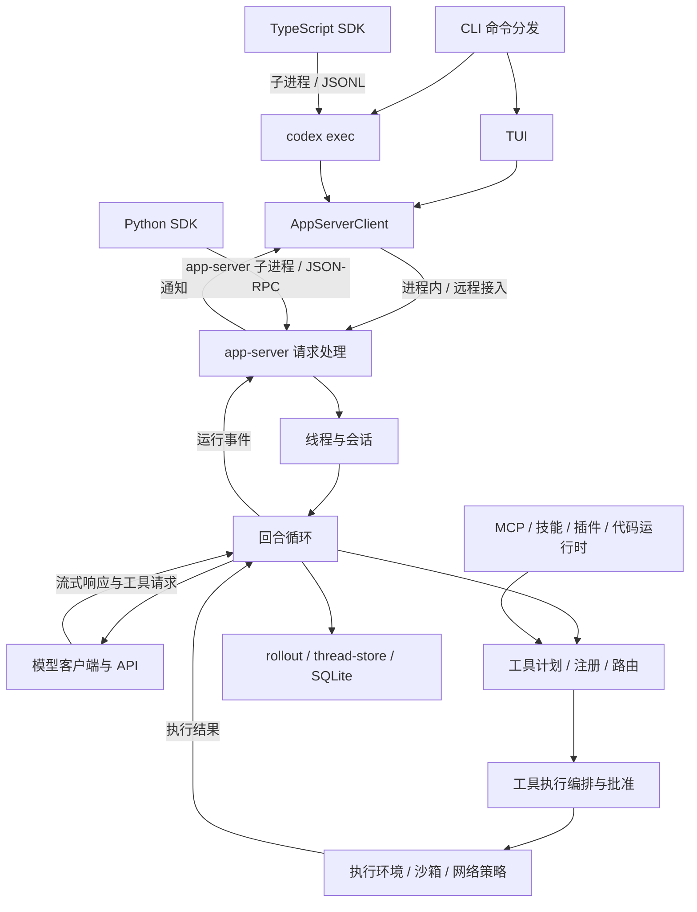

# Codex 新成员上手指南

本指南使用 [Understand-Anything 的 understand-onboard 技能](https://github.com/Egonex-AI/Understand-Anything/blob/532a2e97dc007104f9a1b8d11b6cc16ae7c8cd3a/understand-anything-plugin/skills/understand-onboard/SKILL.md)，从已有[知识图谱](../.ua/knowledge-graph.json)的项目元数据、架构层、文件级节点和学习导览生成，并结合仓库文档核对开发入口。目标是帮助新成员追踪一次请求、定位相关实现，并选择合适的验证方式。

生成日期：2026-11-19。源码基线：[c0cc9fc820f62e4dbdde68214dd6d792d6c8a7ee](https://github.com/AManHasNoName12138/codex/tree/c0cc9fc820f62e4dbdde68214dd6d792d6c8a7ee)。生成前检查的分支提交为 `25ccd4fd23b3fc0022c3a8c41bfb9e1f283231e6`；与图谱基线相比，差异仅在 `.ua/` 生成目录，已暂存、未暂存和未跟踪的项目文件均无变化，因此复用了现有图谱。

## 项目概览

Codex CLI 是在本机运行的 OpenAI 编程代理。本仓库的图谱项目名为 `codex-monorepo`，包含 Rust 工作区、终端与非交互入口、SDK，以及构建、测试和发布工具。先读[仓库 README](../README.md)了解使用方式，再从本指南进入实现。

| 技术                                   | 在仓库中的位置与用途                                                                                              |
| -------------------------------------- | ----------------------------------------------------------------------------------------------------------------- |
| Rust                                   | `codex-rs/` 承载 CLI、应用服务、代理运行时、协议、执行环境和持久化；Cargo workspace 划分 crate 边界。             |
| TypeScript                             | `sdk/typescript/` 提供 SDK；app-server 协议还导出 TypeScript 类型。                                               |
| Python                                 | `sdk/python/` 提供同步和异步 SDK；`scripts/` 等目录包含维护工具。                                                 |
| SQL、TOML、YAML、Bazel/Starlark、Shell | 分别用于数据库迁移、配置、工作流、构建规则和脚本；图谱也纳入文档、快照和数据文件。                                |
| Tokio、Serde、Clap、Ratatui、Axum      | 分别支撑异步运行、序列化、命令行解析、终端界面和部分 HTTP 服务。依赖声明见 [Cargo.toml](../codex-rs/Cargo.toml)。 |
| GitHub Actions                         | 组织 CI、跨平台构建和发布；Cargo 与 Bazel 提供仓库中的构建和测试路径。                                            |

### 准备开发环境

环境与工具版本以仓库文件为准：[安装说明](install.md)、[Rust 工具链](../codex-rs/rust-toolchain.toml)、[根 package.json](../package.json) 和 [Python SDK 配置](../sdk/python/pyproject.toml)。当前基线固定 Rust `1.95.0`，工作区使用 Rust 2024 edition；根 Node 工具要求 Node.js `>=24.22.1`、pnpm `>=10.34.5`，`packageManager` 固定 pnpm `10.34.5`；Python SDK 要求 Python `>=3.10`。TypeScript SDK 单独声明的 Node.js 最低版本是 18，仓库开发时应遵循根目录的工具版本。

安装 Rust/rustup 后，下面的命令从仓库根目录开始。构建不需要模型认证；真正发起代理回合时，按 README 完成登录或 API key 配置。

```bash
cd codex-rs
rustup show active-toolchain
cargo build -p codex-cli
cargo run --bin codex -- --help
```

开发辅助工具的安装方法见 `docs/install.md`：`just` 提供统一命令入口，DotSlash 下载固定版本的辅助工具，`cargo-nextest` 执行 `just test`。根 [justfile](../justfile) 默认在 `codex-rs/` 工作，因此回到仓库根目录后可以按改动范围选择：

```bash
# 格式检查；完整工具准备步骤见安装说明
just fmt-check

# 例如修改 TUI 时，先跑对应 crate 的检查与测试
just clippy -p codex-tui
just test -p codex-tui
```

`just fmt` 和 `just fix -p codex-tui` 会修改文件，执行后应检查 diff。日常验证优先选择受影响 crate；更广泛的测试按改动范围和 CI 要求决定。安装说明不建议在常规本地运行中加 `--all-features`。

## 架构分层

以下 10 层直接沿用图谱的 `layers`。它们是学习和导航分组，实际依赖会跨层；例如 `core/src/tools/` 的注册与编排文件属于“代理编排与上下文”，扩展实现位于“工具扩展与代码运行时”。

| 架构层               | 职责                                                                                            | 建议先看的文件                                                                                                                                                                       |
| -------------------- | ----------------------------------------------------------------------------------------------- | ------------------------------------------------------------------------------------------------------------------------------------------------------------------------------------ |
| 用户界面与 SDK       | 提供 CLI、TUI、语音和非交互入口；TUI/exec 使用 AppServerClient，SDK 提供程序化接入。            | [cli/main.rs](../codex-rs/cli/src/main.rs)、[tui/lib.rs](../codex-rs/tui/src/lib.rs)、[exec/lib.rs](../codex-rs/exec/src/lib.rs)                                                     |
| 应用服务与会话接入   | 管理请求、通知、连接与生命周期，支持进程内客户端以及 stdio、Unix 套接字、WebSocket 等接入方式。 | [app-server-client/lib.rs](../codex-rs/app-server-client/src/lib.rs)、[message_processor.rs](../codex-rs/app-server/src/message_processor.rs)                                        |
| 协议与类型契约       | 定义线程、回合、执行服务、代码会话和后端 API 的共享契约，以及生成类型和 Schema。                | [thread.rs](../codex-rs/app-server-protocol/src/protocol/v2/thread.rs)、[turn.rs](../codex-rs/app-server-protocol/src/protocol/v2/turn.rs)                                           |
| 代理编排与上下文     | 组织线程和回合、配置、提示上下文、模型请求、工具编排、记忆、Guardian 审查和代理协作。           | [thread_manager.rs](../codex-rs/core/src/thread_manager.rs)、[session/turn.rs](../codex-rs/core/src/session/turn.rs)                                                                 |
| 工具扩展与代码运行时 | 提供工具协议、补丁、MCP、连接器、技能、hook、插件及代码会话执行能力。                           | [tools/lib.rs](../codex-rs/tools/src/lib.rs)、[codex-mcp/runtime.rs](../codex-rs/codex-mcp/src/runtime.rs)、[code-mode/lib.rs](../codex-rs/code-mode/src/lib.rs)                     |
| 执行环境与安全隔离   | 统一进程、文件和网络访问，组合执行策略、网络代理、进程加固及各平台隔离实现。                    | [exec-server/lib.rs](../codex-rs/exec-server/src/lib.rs)、[execpolicy/lib.rs](../codex-rs/execpolicy/src/lib.rs)、[network-proxy/policy.rs](../codex-rs/network-proxy/src/policy.rs) |
| 模型与云服务接入     | 接入模型 API、本地模型与云服务，管理提供者能力、模型目录、认证和受管云配置。                    | [model-provider-info/lib.rs](../codex-rs/model-provider-info/src/lib.rs)、[codex-api/lib.rs](../codex-rs/codex-api/src/lib.rs)                                                       |
| 会话状态与持久化     | 保存可回放日志、线程元数据、数据库迁移、历史投影、附件与代理关系。                              | [rollout/recorder.rs](../codex-rs/rollout/src/recorder.rs)、[state/runtime.rs](../codex-rs/state/src/runtime.rs)                                                                     |
| 共享运行基础设施     | 提供分层配置、功能开关、文件与 Git 操作、网络、遥测，以及路径、进程和缓存等公共能力。           | [config/lib.rs](../codex-rs/config/src/lib.rs)、[features/lib.rs](../codex-rs/features/src/lib.rs)、[otel/lib.rs](../codex-rs/otel/src/lib.rs)                                       |
| 工程构建与仓库文档   | 维护 Cargo/Bazel 工作区、开发检查、CI、跨平台打包签名、发布和使用文档。                         | [Cargo.toml](../codex-rs/Cargo.toml)、[justfile](../justfile)、[MODULE.bazel](../MODULE.bazel)、[rust-ci.yml](../.github/workflows/rust-ci.yml)                                      |

### 一次请求经过哪些组件

下面是主要职责之间的衔接图，箭头用于解释运行路径，具体导入和调用关系可继续在知识图谱中查询。



## 关键概念

| 概念                  | 阅读时应建立的理解                                                                                                                                                                                    | 对应入口                                                                                                                                                                                                                                                          |
| --------------------- | ----------------------------------------------------------------------------------------------------------------------------------------------------------------------------------------------------- | ----------------------------------------------------------------------------------------------------------------------------------------------------------------------------------------------------------------------------------------------------------------- |
| Thread、Session、Turn | Thread 是可创建、恢复、分叉的会话单元；Session 保存运行中的配置、服务和状态；TurnContext 汇集当前回合设置，回合循环负责模型请求、工具调用和结束条件。沿协议对象到运行时对象追踪生命周期。             | [thread_manager.rs](../codex-rs/core/src/thread_manager.rs)、[session.rs](../codex-rs/core/src/session/session.rs)、[turn_context.rs](../codex-rs/core/src/session/turn_context.rs)                                                                               |
| 客户端与应用服务      | TUI 和 Rust exec 通过 app-server 客户端接口驱动会话。TUI 可选择进程内或远程客户端，exec 创建进程内客户端。定位界面问题时，应同时关注请求发出和通知消费。                                              | [tui/lib.rs](../codex-rs/tui/src/lib.rs)、[exec/lib.rs](../codex-rs/exec/src/lib.rs)、[app-server-client/lib.rs](../codex-rs/app-server-client/src/lib.rs)                                                                                                        |
| 请求、响应和通知      | 应用服务协议表达客户端操作及异步事件。请求完成与回合完成属于不同阶段；需要同时阅读请求类型、通知类型和事件处理路径。                                                                                  | [ClientRequest.ts](../codex-rs/app-server-protocol/schema/typescript/ClientRequest.ts)、[ServerNotification.ts](../codex-rs/app-server-protocol/schema/typescript/ServerNotification.ts)、[message_processor.rs](../codex-rs/app-server/src/message_processor.rs) |
| 两种 SDK 接入         | TypeScript SDK 启动 `codex exec --experimental-json` 并消费 JSONL；Python SDK 默认启动 `codex app-server --listen stdio://`，管理 JSON-RPC 请求、通知及服务端批准请求。排查时先确认使用的是哪条链路。 | [TS exec.ts](../sdk/typescript/src/exec.ts)、[Python client.py](../sdk/python/src/openai_codex/client.py)                                                                                                                                                         |
| 分层配置与回合设置    | 配置加载合并用户、项目、启动覆盖和受管要求；核心 Config 与 TurnContext 将解析后的设置交给模型和工具。功能开关由独立组件解释。                                                                         | [config/lib.rs](../codex-rs/config/src/lib.rs)、[core/config/mod.rs](../codex-rs/core/src/config/mod.rs)、[features/lib.rs](../codex-rs/features/src/lib.rs)                                                                                                      |
| 上下文与流式执行      | 上下文由带角色和来源的片段组织；回合执行持续处理流式模型输出、待处理输入、压缩、预算及结束条件。改变一处设置时，要检查它对后续步骤的生效时机。                                                        | [context/mod.rs](../codex-rs/core/src/context/mod.rs)、[session/turn.rs](../codex-rs/core/src/session/turn.rs)、[core/client.rs](../codex-rs/core/src/client.rs)                                                                                                  |
| 工具规格、注册与执行  | 工具计划决定模型可见规格，注册表连接规格与处理器，路由器解析和分发调用；编排器再处理批准、执行尝试、取消和沙箱结果。增加工具时应贯通这几处。                                                          | [spec_plan.rs](../codex-rs/core/src/tools/spec_plan.rs)、[registry.rs](../codex-rs/core/src/tools/registry.rs)、[router.rs](../codex-rs/core/src/tools/router.rs)、[orchestrator.rs](../codex-rs/core/src/tools/orchestrator.rs)                                  |
| 批准与环境约束        | 批准回答一次调用如何获准，执行策略和环境负责落实进程、文件及网络访问限制。分析重试或环境切换时，应跟踪同一调用的状态与策略。                                                                          | [sandboxing.rs](../codex-rs/core/src/tools/sandboxing.rs)、[execpolicy/lib.rs](../codex-rs/execpolicy/src/lib.rs)、[exec-server/lib.rs](../codex-rs/exec-server/src/lib.rs)                                                                                       |
| 持久化与恢复          | rollout 保存可回放记录，thread-store 组织线程历史、投影和附件，SQLite state 提供线程元数据等查询入口。理解恢复行为时，把写入、回放和迁移连起来看。                                                    | [rollout/recorder.rs](../codex-rs/rollout/src/recorder.rs)、[thread-store/lib.rs](../codex-rs/thread-store/src/lib.rs)、[state/runtime.rs](../codex-rs/state/src/runtime.rs)                                                                                      |
| 扩展与能力发现        | 技能和插件提供可发现资源及会话指令，MCP 管理外部服务与工具目录，代码会话客户端和宿主处理执行单元及委派回调。能力可见性需要与连接和会话生命周期一起理解。                                              | [skills/lib.rs](../codex-rs/skills/src/lib.rs)、[plugins/mod.rs](../codex-rs/core/src/plugins/mod.rs)、[codex-mcp/runtime.rs](../codex-rs/codex-mcp/src/runtime.rs)、[code-mode/lib.rs](../codex-rs/code-mode/src/lib.rs)                                         |

## 引导式阅读路线

以下顺序保留图谱中的 15 个 tour 步骤。每一步给出阅读重点和一个自检目标；先追踪一条完整请求，再按所负责的模块深入。

### 1. 项目用途与入口

阅读[根 README](../README.md)，了解本地 CLI 的安装、登录方式，以及 IDE、桌面和云端入口。自检：能够说明本仓库提供什么，以及首次运行和源码开发各从哪里开始。

### 2. 工作区与命令路由

阅读 [Rust README](../codex-rs/README.md)、[Cargo 工作区](../codex-rs/Cargo.toml)和 [CLI 入口](../codex-rs/cli/src/main.rs)。从默认交互模式和 `exec`、登录、MCP、插件、app-server 子命令中选一个追踪分派。自检：能指出该入口所属 crate，以及它接下来调用哪个组件。

### 3. 交互与批量入口

对照 [TUI 启动](../codex-rs/tui/src/lib.rs)、[TUI 会话协调](../codex-rs/tui/src/app_server_session.rs)、[exec 入口](../codex-rs/exec/src/lib.rs)和[应用服务客户端](../codex-rs/app-server-client/src/lib.rs)。重点看配置载入、客户端选择、线程启动或恢复和事件消费。自检：能解释 TUI 与 exec 如何复用应用服务能力，以及它们向用户呈现结果的区别。

### 4. 应用服务协议

结合 [app-server 行为说明](../codex-rs/app-server/README.md)，阅读 [thread.rs](../codex-rs/app-server-protocol/src/protocol/v2/thread.rs)、[turn.rs](../codex-rs/app-server-protocol/src/protocol/v2/turn.rs)，再对照生成的 [ClientRequest.ts](../codex-rs/app-server-protocol/schema/typescript/ClientRequest.ts) 和 [ServerNotification.ts](../codex-rs/app-server-protocol/schema/typescript/ServerNotification.ts)。自检：找到线程启动、回合启动与回合完成对应的契约，区分请求结果和后续通知。

### 5. 服务分发与线程

阅读 [app-server 启动](../codex-rs/app-server/src/lib.rs)、[消息分发器](../codex-rs/app-server/src/message_processor.rs)和[线程管理器](../codex-rs/core/src/thread_manager.rs)。关注连接初始化、协议校验、请求分派、线程创建或恢复与关闭。自检：能从一个客户端请求定位到对应处理分支，并追踪它如何接入线程运行。

### 6. 会话与回合循环

依次阅读 [session/mod.rs](../codex-rs/core/src/session/mod.rs)、[session.rs](../codex-rs/core/src/session/session.rs)、[turn_context.rs](../codex-rs/core/src/session/turn_context.rs)、[context/mod.rs](../codex-rs/core/src/context/mod.rs)和 [turn.rs](../codex-rs/core/src/session/turn.rs)。先识别长期状态和本轮设置，再看输入准备、hooks、模型采样、工具调用、上下文压缩与结束条件。自检：能画出一次回合内“请求模型 → 执行工具 → 带结果继续”的路径。

### 7. 配置与模型接入

阅读 [核心 Config](../codex-rs/core/src/config/mod.rs)、[模型提供者配置](../codex-rs/model-provider-info/src/lib.rs)、[登录组件](../codex-rs/login/src/lib.rs)、[核心模型客户端](../codex-rs/core/src/client.rs)和 [模型 API](../codex-rs/codex-api/src/lib.rs)。关注配置解析、凭据来源、请求路由，以及 Responses HTTP/WebSocket 的续接与回退。自检：能从一个模型选项追踪到请求构造，并找到它的具体生效位置。

### 8. 工具计划与路由

阅读 [spec_plan.rs](../codex-rs/core/src/tools/spec_plan.rs)、[registry.rs](../codex-rs/core/src/tools/registry.rs)、[router.rs](../codex-rs/core/src/tools/router.rs)和 [context.rs](../codex-rs/core/src/tools/context.rs)。对照模型可见规格、注册处理器、调用参数、取消状态和结果。自检：选一个工具，指出它在哪里加入计划、如何被路由、由谁执行。

### 9. 执行批准与隔离

从 [orchestrator.rs](../codex-rs/core/src/tools/orchestrator.rs) 和 [sandboxing.rs](../codex-rs/core/src/tools/sandboxing.rs) 进入[执行策略](../codex-rs/execpolicy/src/lib.rs)、[exec-server](../codex-rs/exec-server/src/lib.rs)和[网络策略](../codex-rs/network-proxy/src/policy.rs)。关注批准原因、策略匹配、执行结果，以及重试或环境变化。自检：能解释一次工具调用涉及哪些批准和访问约束，并找到失败返回路径。

### 10. 历史与状态持久化

阅读 [rollout 入口](../codex-rs/rollout/src/lib.rs)、[记录器](../codex-rs/rollout/src/recorder.rs)、[SQLite 运行时](../codex-rs/state/src/runtime.rs)和[首个线程表迁移](../codex-rs/state/migrations/0001_threads.sql)。将回放记录、元数据查询和数据库结构联系起来。自检：能指出线程恢复需要读取哪些信息，以及相关数据在哪里写入。

### 11. 技能与扩展能力

阅读[技能组件](../codex-rs/skills/src/lib.rs)、[核心插件适配](../codex-rs/core/src/plugins/mod.rs)、[MCP 连接管理器](../codex-rs/codex-mcp/src/connection_manager.rs)、[MCP 运行时](../codex-rs/codex-mcp/src/runtime.rs)和[代码会话客户端](../codex-rs/code-mode/src/lib.rs)。追踪发现、认证、启动、目录刷新与指令注入。自检：能区分“能力已被发现”“工具已对模型可见”和“执行连接可用”这几个阶段。

### 12. 脚本接口与事件流

阅读 [TypeScript SDK README](../sdk/typescript/README.md)、[codex.ts](../sdk/typescript/src/codex.ts)、[thread.ts](../sdk/typescript/src/thread.ts)和 [exec.ts](../sdk/typescript/src/exec.ts)。把 `run`/`runStreamed` 与子进程参数、标准输入和逐行 JSON 事件联系起来。自检：能追踪一次 SDK 调用到 `codex exec --experimental-json`，并定位取消和子进程退出的处理。

### 13. 异步接口与会话订阅

阅读 [Python SDK README](../sdk/python/README.md)、[api.py](../sdk/python/src/openai_codex/api.py)、[client.py](../sdk/python/src/openai_codex/client.py)、[async_client.py](../sdk/python/src/openai_codex/async_client.py)和 [\_message_router.py](../sdk/python/src/openai_codex/_message_router.py)。从用户对象进入 stdio JSON-RPC 客户端，再看等待者、回合订阅和异步包装。自检：能解释一条响应或通知怎样交付给同步或异步调用方。

### 14. 行为测试与场景

从[核心测试目录入口](../codex-rs/core/tests/suite/mod.rs)、[场景测试](../codex-rs/core/tests/suite/scenarios.rs)和 [app-server v2 测试入口](../codex-rs/app-server/tests/suite/v2/mod.rs)选择与所读路径有关的案例。记录输入、状态变化和断言；涉及快照时，结合生成快照的测试一起读。自检：能为一个准备修改的行为找到相关测试，并通过断言确认预期行为。

### 15. 构建与贡献验证

阅读[安装与构建说明](install.md)、[贡献政策](contributing.md)、[MODULE.bazel](../MODULE.bazel)、[Bazel 工作流](../.github/workflows/bazel.yml)和 [Rust CI](../.github/workflows/rust-ci.yml)。结合 `justfile` 为所选 crate 确定格式、静态检查和测试命令。当前 `docs/contributing.md` 明确说明上游不接受外部代码贡献或 PR，欢迎问题报告、复现和分析；本 fork 的学习与分支维护应与该上游政策区分。自检：能给出一次具体修改的验证范围，并说明哪些检查仍需 CI 执行。

首次通读可以分三段进行：1–5 步建立入口与协议认识，6–11 步追踪运行时，12–15 步连接 SDK、测试和开发流程。随后选定负责的模块，重复“入口 → 契约 → 实现 → 测试”的定位过程。

## 关键文件地图

以下按图谱中的层归属组织，只选文件级结构节点。每行说明该文件在学习中的作用；函数和类型细节留给源码及完整图谱。

### 用户界面与 SDK

| 文件                                                                                                 | 作用                                                               |
| ---------------------------------------------------------------------------------------------------- | ------------------------------------------------------------------ |
| [codex-rs/cli/src/main.rs](../codex-rs/cli/src/main.rs)                                              | 解析顶层命令与配置覆盖，将子命令分派到对应组件。                   |
| [codex-rs/tui/src/lib.rs](../codex-rs/tui/src/lib.rs)                                                | 启动终端应用，加载配置并选择应用服务客户端。                       |
| [codex-rs/tui/src/app_server_session.rs](../codex-rs/tui/src/app_server_session.rs)                  | 协调线程切换、后台事件、用户提交和批准操作。                       |
| [codex-rs/tui/src/chatwidget.rs](../codex-rs/tui/src/chatwidget.rs)                                  | 组织聊天界面状态、输入草稿、会话事件和显示记录。                   |
| [codex-rs/exec/src/lib.rs](../codex-rs/exec/src/lib.rs)                                              | 建立进程内客户端并驱动非交互回合，处理输出、批准、取消与退出状态。 |
| [sdk/typescript/src/codex.ts](../sdk/typescript/src/codex.ts)                                        | 提供 TypeScript SDK 的 Codex 入口和线程创建接口。                  |
| [sdk/typescript/src/thread.ts](../sdk/typescript/src/thread.ts)                                      | 封装线程调用与事件流消费。                                         |
| [sdk/typescript/src/exec.ts](../sdk/typescript/src/exec.ts)                                          | 定位并启动 CLI，组装参数，读写子进程事件流。                       |
| [sdk/python/src/openai_codex/api.py](../sdk/python/src/openai_codex/api.py)                          | 提供 Codex、AsyncCodex、Thread 等用户接口。                        |
| [sdk/python/src/openai_codex/client.py](../sdk/python/src/openai_codex/client.py)                    | 管理同步 app-server 客户端、请求关联与批准请求。                   |
| [sdk/python/src/openai_codex/async_client.py](../sdk/python/src/openai_codex/async_client.py)        | 在同步客户端上提供可等待调用及通知迭代。                           |
| [sdk/python/src/openai_codex/\_message_router.py](../sdk/python/src/openai_codex/_message_router.py) | 将响应和通知交付给等待者及回合订阅。                               |

### 应用服务与会话接入

| 文件                                                                                            | 作用                                                     |
| ----------------------------------------------------------------------------------------------- | -------------------------------------------------------- |
| [codex-rs/app-server-client/src/lib.rs](../codex-rs/app-server-client/src/lib.rs)               | 定义客户端入口、事件和错误，连接进程内、远程或云端服务。 |
| [codex-rs/app-server/src/lib.rs](../codex-rs/app-server/src/lib.rs)                             | 启动服务运行环境，管理连接、日志和关闭信号。             |
| [codex-rs/app-server/src/message_processor.rs](../codex-rs/app-server/src/message_processor.rs) | 检查初始化状态和协议字段，分发请求、通知与对端响应。     |
| [codex-rs/app-server/README.md](../codex-rs/app-server/README.md)                               | 记录服务端行为、实验能力和边界条件。                     |
| [codex-rs/app-server/tests/suite/v2/mod.rs](../codex-rs/app-server/tests/suite/v2/mod.rs)       | 导航 v2 协议的行为测试。                                 |

### 协议与类型契约

| 文件                                                                                                                                            | 作用                                         |
| ----------------------------------------------------------------------------------------------------------------------------------------------- | -------------------------------------------- |
| [codex-rs/protocol/src/protocol.rs](../codex-rs/protocol/src/protocol.rs)                                                                       | 表达共享会话、输入、模型配置与运行事件契约。 |
| [codex-rs/app-server-protocol/src/protocol/v2/thread.rs](../codex-rs/app-server-protocol/src/protocol/v2/thread.rs)                             | 定义线程相关请求与传输数据。                 |
| [codex-rs/app-server-protocol/src/protocol/v2/turn.rs](../codex-rs/app-server-protocol/src/protocol/v2/turn.rs)                                 | 定义回合状态和设置等协议数据。               |
| [codex-rs/app-server-protocol/schema/typescript/ClientRequest.ts](../codex-rs/app-server-protocol/schema/typescript/ClientRequest.ts)           | 展示生成的客户端请求联合类型。               |
| [codex-rs/app-server-protocol/schema/typescript/ServerNotification.ts](../codex-rs/app-server-protocol/schema/typescript/ServerNotification.ts) | 展示生成的服务端通知联合类型。               |

### 代理编排与上下文

| 文件                                                                                      | 作用                                                           |
| ----------------------------------------------------------------------------------------- | -------------------------------------------------------------- |
| [codex-rs/core/src/thread_manager.rs](../codex-rs/core/src/thread_manager.rs)             | 创建、恢复、注册和分叉线程，衔接历史装载。                     |
| [codex-rs/core/src/session/mod.rs](../codex-rs/core/src/session/mod.rs)                   | 组织会话状态、线程启动、输入提交和运行服务。                   |
| [codex-rs/core/src/session/session.rs](../codex-rs/core/src/session/session.rs)           | 保存会话配置、服务与运行状态，提供共享访问接口。               |
| [codex-rs/core/src/session/turn_context.rs](../codex-rs/core/src/session/turn_context.rs) | 构造本轮环境、沙箱、shell 快照和上下文依赖。                   |
| [codex-rs/core/src/session/turn.rs](../codex-rs/core/src/session/turn.rs)                 | 运行回合循环，协调输入、模型流、工具、压缩与预算。             |
| [codex-rs/core/src/context/mod.rs](../codex-rs/core/src/context/mod.rs)                   | 汇集注入模型输入的上下文片段及相关类型。                       |
| [codex-rs/core/src/config/mod.rs](../codex-rs/core/src/config/mod.rs)                     | 构造核心 Config，解析模型、权限、网络、认证和运行路径。        |
| [codex-rs/core/src/client.rs](../codex-rs/core/src/client.rs)                             | 维护模型请求状态、路由和遥测，协调 HTTP/WebSocket 续接与回退。 |
| [codex-rs/core/src/tools/spec_plan.rs](../codex-rs/core/src/tools/spec_plan.rs)           | 建立工具计划，关联可见规格和实际处理器。                       |
| [codex-rs/core/src/tools/registry.rs](../codex-rs/core/src/tools/registry.rs)             | 保存注册规格、暴露方式、审核能力和运行时接口。                 |
| [codex-rs/core/src/tools/router.rs](../codex-rs/core/src/tools/router.rs)                 | 解析工具调用并分派给注册处理器，传递取消状态和结果。           |
| [codex-rs/core/src/tools/context.rs](../codex-rs/core/src/tools/context.rs)               | 组织调用状态、来源和执行上下文。                               |
| [codex-rs/core/src/tools/orchestrator.rs](../codex-rs/core/src/tools/orchestrator.rs)     | 协调批准、执行尝试、环境切换与结果。                           |
| [codex-rs/core/src/tools/sandboxing.rs](../codex-rs/core/src/tools/sandboxing.rs)         | 管理批准状态和原因等工具执行辅助逻辑。                         |
| [codex-rs/core/src/plugins/mod.rs](../codex-rs/core/src/plugins/mod.rs)                   | 将插件目录、显式提及和指令注入接入核心会话。                   |
| [codex-rs/core/tests/suite/mod.rs](../codex-rs/core/tests/suite/mod.rs)                   | 导航核心运行时的测试模块。                                     |
| [codex-rs/core/tests/suite/scenarios.rs](../codex-rs/core/tests/suite/scenarios.rs)       | 定义场景测试，包括技能扩展和能力目录相关设置。                 |

### 工具扩展与代码运行时

| 文件                                                                                            | 作用                                                       |
| ----------------------------------------------------------------------------------------------- | ---------------------------------------------------------- |
| [codex-rs/tools/src/lib.rs](../codex-rs/tools/src/lib.rs)                                       | 汇集工具规格、载荷、搜索目录和响应表示。                   |
| [codex-rs/apply-patch/src/lib.rs](../codex-rs/apply-patch/src/lib.rs)                           | 组织补丁文本解析、定位和文件修改。                         |
| [codex-rs/skills/src/lib.rs](../codex-rs/skills/src/lib.rs)                                     | 组织技能配置、发现和内置资源安装。                         |
| [codex-rs/codex-mcp/src/connection_manager.rs](../codex-rs/codex-mcp/src/connection_manager.rs) | 管理服务连接、发现结果和可复用客户端。                     |
| [codex-rs/codex-mcp/src/runtime.rs](../codex-rs/codex-mcp/src/runtime.rs)                       | 协调 MCP 启动、认证、工具刷新及连接生命周期。              |
| [codex-rs/code-mode/src/lib.rs](../codex-rs/code-mode/src/lib.rs)                               | 导出代码会话客户端能力，衔接执行单元、会话连接和工具委派。 |
| [codex-rs/code-mode-host/src/lib.rs](../codex-rs/code-mode-host/src/lib.rs)                     | 管理代码执行宿主状态、连接和执行容量。                     |

### 执行环境与安全隔离

| 文件                                                                            | 作用                                       |
| ------------------------------------------------------------------------------- | ------------------------------------------ |
| [codex-rs/exec-server/src/lib.rs](../codex-rs/exec-server/src/lib.rs)           | 提供统一执行环境服务的入口和完整性检查。   |
| [codex-rs/execpolicy/src/lib.rs](../codex-rs/execpolicy/src/lib.rs)             | 导出命令规则解析、匹配及相关执行策略能力。 |
| [codex-rs/network-proxy/src/policy.rs](../codex-rs/network-proxy/src/policy.rs) | 表达目的地址、域名模式与协议访问策略。     |

### 模型与云服务接入

| 文件                                                                                  | 作用                                                 |
| ------------------------------------------------------------------------------------- | ---------------------------------------------------- |
| [codex-rs/model-provider-info/src/lib.rs](../codex-rs/model-provider-info/src/lib.rs) | 描述提供者能力、认证方式和 API 路由。                |
| [codex-rs/codex-api/src/lib.rs](../codex-rs/codex-api/src/lib.rs)                     | 导出模型、图像、记忆和实时接口的请求及事件解析能力。 |
| [codex-rs/login/src/lib.rs](../codex-rs/login/src/lib.rs)                             | 汇集账户认证模块，包括凭据保存和刷新。               |
| [codex-rs/ollama/src/lib.rs](../codex-rs/ollama/src/lib.rs)                           | 接入本地 Ollama 服务并检查模型可用性。               |
| [codex-rs/lmstudio/src/lib.rs](../codex-rs/lmstudio/src/lib.rs)                       | 导出 LM Studio 本地模型服务接入。                    |

### 会话状态与持久化

| 文件                                                                                        | 作用                                                              |
| ------------------------------------------------------------------------------------------- | ----------------------------------------------------------------- |
| [codex-rs/rollout/src/lib.rs](../codex-rs/rollout/src/lib.rs)                               | 提供回放记录的解析与日志模块入口。                                |
| [codex-rs/rollout/src/recorder.rs](../codex-rs/rollout/src/recorder.rs)                     | 记录会话日志，组织记录器状态和写入生命周期。                      |
| [codex-rs/thread-store/src/lib.rs](../codex-rs/thread-store/src/lib.rs)                     | 导出线程元数据、历史投影、附件和迁移能力。                        |
| [codex-rs/state/src/runtime.rs](../codex-rs/state/src/runtime.rs)                           | 初始化 SQLite，提供线程元数据、回填、记忆、完整性检查及关闭入口。 |
| [codex-rs/state/migrations/0001_threads.sql](../codex-rs/state/migrations/0001_threads.sql) | 创建初始线程表与索引，作为阅读后续迁移的起点。                    |

### 共享运行基础设施

| 文件                                                            | 作用                                             |
| --------------------------------------------------------------- | ------------------------------------------------ |
| [codex-rs/config/src/lib.rs](../codex-rs/config/src/lib.rs)     | 导出分层配置加载、合并和权限约束能力。           |
| [codex-rs/features/src/lib.rs](../codex-rs/features/src/lib.rs) | 定义和解释功能开关及启用行为。                   |
| [codex-rs/otel/src/lib.rs](../codex-rs/otel/src/lib.rs)         | 汇集会话、工具、模型和运行资源的指标及追踪接口。 |

### 工程构建与仓库文档

| 文件                                                              | 作用                                                  |
| ----------------------------------------------------------------- | ----------------------------------------------------- |
| [README.md](../README.md)                                         | 项目用途、安装、登录和主要文档入口。                  |
| [codex-rs/README.md](../codex-rs/README.md)                       | Rust 目录的 CLI 文档入口。                            |
| [codex-rs/Cargo.toml](../codex-rs/Cargo.toml)                     | 声明工作区成员、共享依赖、构建 profile 和 lint 规则。 |
| [codex-rs/rust-toolchain.toml](../codex-rs/rust-toolchain.toml)   | 固定 Rust 版本及工具组件。                            |
| [package.json](../package.json)                                   | 声明仓库 Node 工具版本和格式检查脚本。                |
| [justfile](../justfile)                                           | 统一启动、格式、静态检查、测试及 Schema 生成命令。    |
| [MODULE.bazel](../MODULE.bazel)                                   | 声明 Bazel 模块、外部依赖与工具链。                   |
| [.github/workflows/bazel.yml](../.github/workflows/bazel.yml)     | 组织可复用的跨平台 Bazel 构建与测试。                 |
| [.github/workflows/rust-ci.yml](../.github/workflows/rust-ci.yml) | 根据变更区域选择 Rust 检查任务。                      |
| [docs/install.md](install.md)                                     | 说明环境、构建和本地开发辅助工具。                    |
| [docs/contributing.md](contributing.md)                           | 说明当前上游贡献政策、问题报告和反馈渠道。            |

## 复杂度热点

图谱使用 `simple`、`moderate`、`complex` 三级标签，其中 `complex` 为最高级。文件级结构节点中有 2,856 个标记为 `complex`；这是一项导航提示，不能解释为圈复杂度、缺陷数量或精确风险排名。下面选择主执行路径上的代表文件，均具有该最高标签。

| 文件                                                                                                 | 为什么需要仔细阅读                                            | 推荐阅读与验证重点                                    |
| ---------------------------------------------------------------------------------------------------- | ------------------------------------------------------------- | ----------------------------------------------------- |
| [core/src/session/turn.rs](../codex-rs/core/src/session/turn.rs)                                     | 将输入、hooks、模型流、工具、压缩和预算放进同一回合生命周期。 | 先找开始、继续和结束路径，再检查取消及工具结果回传。  |
| [core/src/config/mod.rs](../codex-rs/core/src/config/mod.rs)                                         | 汇集多来源配置与权限、网络、模型和路径设置。                  | 用一个具体设置追踪来源、覆盖顺序及最终生效位置。      |
| [core/src/client.rs](../codex-rs/core/src/client.rs)                                                 | 同时处理模型会话状态、路由、流式连接和回退。                  | 对照请求构造与事件消费，关注续接失败时的状态变化。    |
| [app-server/src/message_processor.rs](../codex-rs/app-server/src/message_processor.rs)               | 位于多种请求、连接状态和通知的交汇处。                        | 选定一种请求，追踪初始化校验、分派和错误响应。        |
| [tui/src/app_server_session.rs](../codex-rs/tui/src/app_server_session.rs)                           | 同时协调界面状态、线程切换、后台事件和批准。                  | 比较切换线程前后的事件归属，核对取消和恢复路径。      |
| [exec/src/lib.rs](../codex-rs/exec/src/lib.rs)                                                       | 将会话生命周期转换成文本或 JSONL 输出与进程退出状态。         | 从线程建立走到回合结束，检查异常、取消和事件输出。    |
| [core/src/tools/orchestrator.rs](../codex-rs/core/src/tools/orchestrator.rs)                         | 连接批准、执行尝试和沙箱结果，涉及重试及环境变化。            | 跟踪同一个调用的批准状态和每次执行结果。              |
| [codex-mcp/src/runtime.rs](../codex-rs/codex-mcp/src/runtime.rs)                                     | 协调服务启动、认证、连接及工具目录刷新。                      | 分别查看连接成功、启动失败和刷新后的可见工具。        |
| [state/src/runtime.rs](../codex-rs/state/src/runtime.rs)                                             | 汇集数据库初始化、查询、回填、完整性检查与关闭。              | 结合迁移和相关测试，核对读写、恢复及关闭边界。        |
| [sdk/python/src/openai_codex/\_message_router.py](../sdk/python/src/openai_codex/_message_router.py) | 管理并发等待者、通知和线程/回合订阅状态。                     | 区分请求 ID 与线程/回合身份，跟踪等待结束和通知投递。 |

首次修改时，选择一个能通过现有测试描述的小行为：定位入口与协议，读调用方和处理方，找到相关测试，再确定改动与验证范围。协议变更还应检查生成类型；根 `justfile` 的 `write-app-server-schema` 会生成 app-server Schema 及由其派生的 Python SDK 内容。

## 使用图谱继续学习

完整图谱涵盖 10,183 个文件、68,121 个节点和 129,845 条关系。本指南只使用文件级节点组织导航；需要追踪函数、类型、导入或清单依赖时，可查看[图谱说明与仪表盘启动方法](../.ua/README.md)。[分析报告](../.ua/analysis-report.json)和[校验报告](../.ua/validation-report.json)记录了覆盖范围与校验结果。

图谱来自静态分析与语义整理，动态调用、条件编译和测试覆盖关系并不完整；未出现一条关系不能证明没有依赖或没有测试。本文的开发命令根据安装文档、清单和 `justfile` 核对，生成本指南时没有运行 Rust 构建或测试套件。

后续源码变化后，应先运行 Understand-Anything 的 `/understand` 更新图谱，再运行 `/understand-onboard` 更新本指南。这里记录的源码基线是图谱分析时的版本，本指南自身及后续生成文档的提交不会自动更新图谱元数据。
